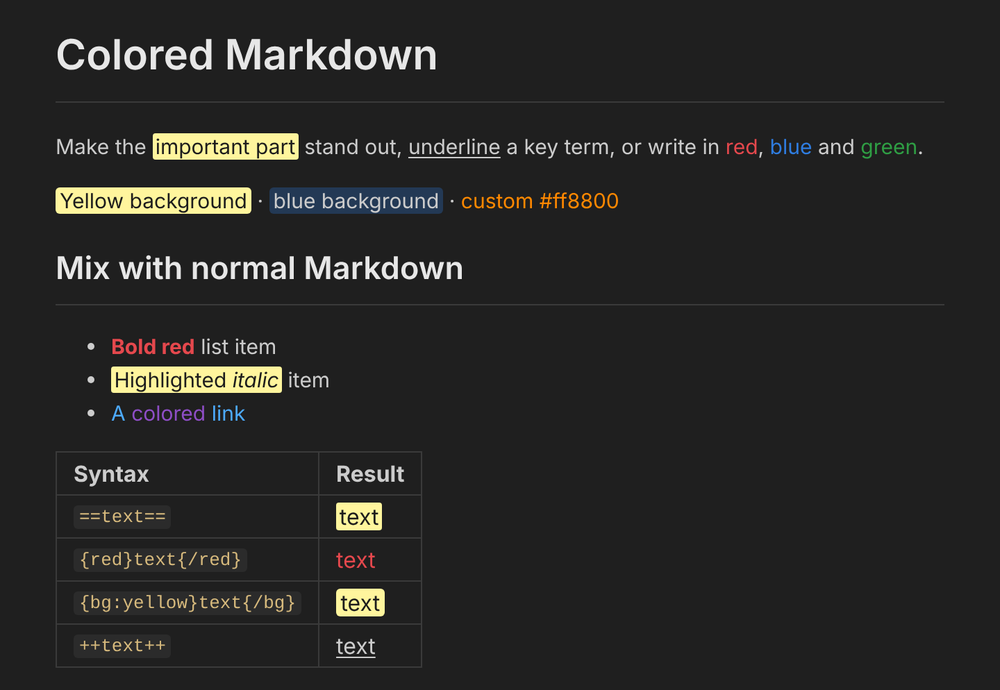

# Colored Markdown

Add **highlights, colors, backgrounds and underlines** to your Markdown with a simple, readable syntax, and see the result instantly in VS Code's live preview.



## Features

| You type | You get |
|---|---|
| `==text==` | Yellow highlight |
| `{red}text{/red}` | Red text |
| `{blue}text{/blue}` | Blue text |
| `{bg:yellow}text{/bg}` | Colored background |
| `++text++` | Underline |

- **Live preview as you type.** Open the preview (`Ctrl+K V` / `Cmd+K V`, or the *Colored Markdown: Open Live Preview to the Side* command) and it updates on every keystroke.
- **Colors in the editor too.** The syntax is colored directly in the editor, and the markers are dimmed so the text stays easy to read. Turn it off with `coloredMarkdown.editorDecorations`.
- **Standard Markdown keeps working.** Headings, lists, tables, code, links, emphasis and everything else render exactly as before. The new syntax is ignored inside code blocks and inline code.
- **Nesting works.** `{bg:yellow}{red}**bold red on yellow**{/red}{/bg}` and `++==underlined highlight==++` are both fine.

### Available colors

`red`, `blue`, `green`, `yellow`, `orange`, `purple`, `pink`, `cyan`, `teal`, `gray` / `grey`, `brown`, `black`, `white`

Any of these work for text (`{green}…{/green}`) and for backgrounds (`{bg:green}…{/bg}`).

### Custom colors

Use any hex value or CSS color name:

```markdown
{color:#ff8800}orange-ish text{/color}
{color:tomato}tomato text{/color}
{bg:#ccffcc}light green background{/bg}
```

Values are validated, so only plain colors (`#rgb`, `#rgba`, `#rrggbb`, `#rrggbbaa` or a color name) are accepted.

### Escaping

Put a backslash in front to show the syntax literally: `\==not highlighted==`.

## Commands and shortcuts

Select text, then use the editor's right-click menu **Colored Markdown**, or the Command Palette:

| Command | Shortcut |
|---|---|
| Colored Markdown: Highlight (`==text==`) | `Ctrl+Alt+H` / `Cmd+Alt+H` |
| Colored Markdown: Underline (`++text++`) | `Ctrl+Alt+U` / `Cmd+Alt+U` |
| Colored Markdown: Text Color… | |
| Colored Markdown: Background Color… | |
| Colored Markdown: Open Live Preview to the Side | |

## Settings

| Setting | Default | Description |
|---|---|---|
| `coloredMarkdown.editorDecorations` | `true` | Color the syntax directly in the Markdown editor. |

## Notes

- The colors appear in VS Code's Markdown preview and in the editor. Other Markdown renderers (GitHub, for example) do not know this syntax and will show it as plain text.
- The extension has no runtime dependencies and does not collect any data.

## Development

```bash
npm install
npm test                  # unit tests (markdown-it plugin and editor scanner)
npm run test:integration  # runs the extension inside a real VS Code instance
npm run package           # builds colored-markdown-<version>.vsix
```

Press `F5` in VS Code to launch an Extension Development Host with the extension loaded.

## License

[MIT](LICENSE)
